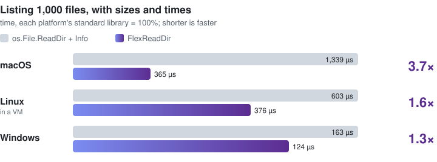

<div align="center">


**A small, highly optimized directory lister written in Go.<br>Every file's size and modification time, in one pass.**

[](https://pkg.go.dev/github.com/pbednarcik/flexreaddir/frd)
[](https://github.com/pbednarcik/flexreaddir/actions/workflows/ci.yml)
[](https://github.com/pbednarcik/flexreaddir/tags)


[](LICENSE)

</div>

- **One pass, every answer.** Names, types, sizes, modification and change
  times and file ids, straight from the listing.
- **Each platform's bulk call.** `getattrlistbulk` on macOS, `getdents64` with
  `statx` on Linux, `FILE_ID_EXTD_DIR_INFO` on Windows.
- **Names and types alone, when that is all you need.** `Lister.Names` lists
  by `getdirentries64` on macOS, which reads the directory's records and
  leaves the files' vnodes alone, skips the `statx` per file on Linux, and
  asks for the shorter record without the file id on Windows.
- **Profiled down to the kernel.** FlexReadDir's own code is about 4% of a
  listing on macOS, 5% on Linux and under 13% on Windows; the rest is the
  operating system's time.
- **A handful of allocations** per listing, whatever its size: 4 or 5 for
  1,000 files, where the standard library makes 2,000 to 5,000.
- **SIMD on Windows.** Names are decoded from UTF-16 with AVX2 or SSE2, tested
  exhaustively against a pure-Go decoder.
- **No cgo**, on any platform.

## Quick start

```sh
go get github.com/pbednarcik/flexreaddir/frd
```

```go
package main

import (
	"fmt"
	"log"

	"github.com/pbednarcik/flexreaddir/frd"
)

func main() {
	entries, err := frd.ReadDir(".")
	if err != nil {
		log.Fatal(err)
	}
	for _, e := range entries {
		if e.Type.IsRegular() {
			fmt.Printf("%-24s %8d bytes  %s\n", e.Name, e.Size, e.ModTime().Format("2006-01-02 15:04"))
		}
	}
}
```

`ReadDir` sorts by name, as `os.ReadDir` does. Listing many directories? Keep
a [`Lister`](#lister) per goroutine and reuse the result slice, so a walk
allocates a few times per directory.

## Speed

<p align="center">
  
</p>

Every name and type, plus the size and modification time of every regular
file, from one directory; lower is better.

| Platform | Files | `ReadDir` + `Info` | `Readdir` | FlexReadDir | Faster |
|---|---:|---:|---:|---:|---:|
| macOS | 1,000 | 1,339 µs | 910 µs | **365 µs** | **3.7×** |
| | 10 | 24.5 µs | 20.0 µs | **12.7 µs** | **1.9×** |
| Linux (VM) | 1,000 | 603 µs | 465 µs | **376 µs** | **1.6×** |
| | 10 | 7.8 µs | 6.7 µs | **5.8 µs** | **1.3×** |
| Windows | 1,000 | 163.4 µs | 161.5 µs | **123.7 µs** | **1.3×** |
| | 10 | 15.7 µs | 15.6 µs | **13.8 µs** | **1.1×** |

"Faster" is against `os.File.ReadDir` with `Info` for each entry, the usual
way; `os.File.Readdir` is the older API that returns a `FileInfo` per entry.
Windows already returns sizes and times with the listing, so the saving there
is the per-entry work the standard library does in user space. FlexReadDir
lists one directory and does not walk trees, so it is compared with the
standard library's listing, not with tree walkers.

### Machines and method

| | macOS | Linux | Windows |
|---|---|---|---|
| CPU | Apple M5 Max, 18 cores (6 super, 12 performance) | the same Mac, 18 vCPUs | AMD Ryzen 9 9950X, Zen 5, 16 cores, 32 threads |
| Memory | 128 GB | the VM's share of the Mac's | 96 GB |
| System | macOS 27.0.1 | OrbStack's Linux VM, kernel 7.0, a Docker container (`golang:1.27`, arm64) | Windows 11 Pro |
| Storage | APFS on the internal SSD | a Docker volume (btrfs) inside the VM, not a folder shared from the Mac | NTFS on an Intel Optane P5800X, a RAM block cache in front of it |
| Go | 1.27.3 | 1.27.1 | 1.27.0 |
| Runs | natively | in a VM | natively, pinned to one 8-core CCD |

Linux is not bare metal: a VM adds cost to every system call, so its rows show
the direction, not the size.

Every row is the median of ten interleaved runs on a warm file cache, so they
measure the code, not the disk; every row's 95% confidence interval is within
±5% of its median. To reproduce:

```sh
for i in $(seq 10); do go test ./frd -run '^$' -bench 'AppendDir' -benchmem -count 1; done
```

### Help wanted

Some machines are simply not on my desk, so these are not measured yet:

- **Linux on real hardware**, not a VM.
- **Intel CPUs**, where the Windows name decoder's AVX2 and SSE2 paths have
  never run against a stopwatch.
- **Network filesystems** such as NFS and SMB.

If you have one of these, the command above takes a minute; an issue with its
output and a line about the machine would be very welcome.

## API

Twelve names. Full documentation and runnable examples, including a tree walk,
are on [pkg.go.dev](https://pkg.go.dev/github.com/pbednarcik/flexreaddir/frd#pkg-examples),
where the three macOS names show under its darwin platform selector.

| Name | What it does |
|---|---|
| [`ReadDir`](#readdir) | Lists a directory by name, sorted as `os.ReadDir` sorts. |
| [`AppendDir`](#appenddir) | Lists an open directory, appending to a slice you reuse. |
| [`Lister`](#lister) | Owns the listing buffer, for walkers; also lists raw handles, and names and types only with `Names` set. |
| [`Volume`](#volume) | Asks what the volume holding a descriptor can do: persistent file ids, case sensitivity, directory hard links. macOS only. |
| [`VolumeCaps`](#volume) | The volume's format capabilities, each bit as (set, known). macOS only. |
| [`DirLinks`](#dirlinks) | A directory's link count. macOS only. |
| [`Entry`](#entry) | One entry: name, type, size, times and file id. |
| [`Entry.ModTime`](#entrymodtime) | The modification time as a `time.Time`. |
| [`CompareName`, `SortByName`](#comparename-and-sortbyname) | Byte order by name, the order `os.ReadDir` returns. |
| [`ErrMalformed`](#errmalformed) | The kernel's buffer did not hold what it claimed. |

### `ReadDir`

```go
func ReadDir(name string) ([]Entry, error)
```

| Parameter | Type | Description |
|---|---|---|
| `name` | `string` | The path of the directory to list. |
| **returns** | `[]Entry` | Its entries, sorted by name; an empty, non-nil slice for an empty directory. |
| **returns** | `error` | `nil`, or an `*os.PathError`: from the open, `ENOTDIR` for a name that is not a directory, or from the listing or an entry's stat, with the entries read before it. |

It returns the same order and the same empty slice as `os.ReadDir`. Its errors
can differ, since it also reads each file's metadata: see the platform notes under
[`AppendDir`](#appenddir). It borrows a pooled buffer, as the function
`AppendDir` does; a walker keeps a [`Lister`](#lister) instead.

### `AppendDir`

```go
func AppendDir(dst []Entry, dir *os.File) ([]Entry, error)
```

| Parameter | Type | Description |
|---|---|---|
| `dst` | `[]Entry` | The slice to append to: `nil`, or a previous result as `entries[:0]` to reuse its storage. |
| `dir` | `*os.File` | An open directory, read from its current offset to its end. It is not closed. |
| **returns** | `[]Entry` | `dst` with one `Entry` per name appended, in the kernel's order. |
| **returns** | `error` | `nil`, or an `*os.PathError` naming the entry that failed, or the directory when the listing call itself failed; the entries read before it are returned with it. |

Reads the open directory `dir` from its current offset to its end and appends
one `Entry` per name to `dst`.

- Entries come in the order the kernel gives them; [`SortByName`](#comparename-and-sortbyname)
  sorts them as `os.ReadDir` does.
- `"."` and `".."` are never included.
- A symbolic link is reported as a link and not followed; a Windows junction
  is `fs.ModeIrregular`, as `os.ReadDir` reports it since Go 1.23.
- A name removed between the read and its stat is left out.
- Don't mix it with the file's own `ReadDir`, `Readdir` or `Readdirnames`:
  they buffer entries the native listing cannot see. Reopen the directory to
  switch.

```go
f, err := os.Open(dir)
if err != nil {
	return err
}
defer func() { _ = f.Close() }()

entries, err := frd.AppendDir(nil, f)
if err != nil {
	return err
}
for _, e := range entries {
	if e.Type.IsRegular() {
		fmt.Println(e.Name, e.Size)
	}
}
```

> [!TIP]
> Reuse the result across directories: pass the previous one truncated to
> zero length, and a walk allocates only a few times per directory.

```go
var entries []frd.Entry
for _, dir := range dirs {
	f, err := os.Open(dir)
	if err != nil {
		return err
	}
	entries, err = frd.AppendDir(entries[:0], f)
	_ = f.Close()
	if err != nil {
		return err
	}
	// use entries before the next iteration overwrites them
}
```

<details>
<summary>Two directories behave differently on macOS</summary>

One that may be read but not searched (`r` without `x`) fails as a whole with
a permission error naming the directory, even when it is empty, where
`os.ReadDir` lists its names; on Linux the listing fails at the first name it
has to stat. And in `/dev/fd`, which holds the caller's own descriptors,
`getattrlistbulk` reports every entry as `fs.ModeIrregular` and stops with
`EBADF` at a descriptor `lstat` cannot describe either, such as the Go
runtime's kqueue; `os.ReadDir` follows each with `lstat` instead.

</details>

### `Lister`

```go
type Lister struct {
	Names  bool // list names and types only
	Rewind bool // list each directory from its first entry
	/* the buffer the kernel fills */
}

func (l *Lister) AppendDir(dst []Entry, dir *os.File) ([]Entry, error)
func (l *Lister) AppendHandle(dst []Entry, fd uintptr, name string) ([]Entry, error)
```

`Lister.AppendDir` takes and returns what the function [`AppendDir`](#appenddir) does.
`AppendHandle`:

| Parameter | Type | Description |
|---|---|---|
| `dst` | `[]Entry` | The slice to append to, as for `AppendDir`. |
| `fd` | `uintptr` | A raw directory handle: a Windows `HANDLE` or a Unix file descriptor, the value `os.File.Fd` returns. Read from its current position, or from its first entry under `Rewind`; never closed. |
| `name` | `string` | The directory's path, used only in error messages. |
| **returns** | `[]Entry` | `dst` with one `Entry` per name appended. |
| **returns** | `error` | As for `AppendDir`; on platforms other than macOS, Linux and Windows, an error wrapping `errors.ErrUnsupported`. |

The function `AppendDir` borrows its 64 KiB buffer from a `sync.Pool`, which
may drop it at any garbage collection. A `Lister` owns its buffer for as long
as you keep it, so a walker keeps one per goroutine.

- The zero `Lister` is ready to use.
- It must not be used by two goroutines at once, nor copied after its first
  use.
- One directory is listed by one goroutine at a time: two calls on one
  `os.File` share its offset and split its entries between them.

Set `Names` to list names and types only: every `Entry` has `Name` and
`Type`, and `Size`, `ModTimeNanos`, `ChangeTimeNanos` and `FileID` are zero,
on every platform. On macOS the listing is `getdirentries64`, the call
`readdir` makes: it reads the directory's records alone, so it costs the same
whether or not the files' vnodes are cached, and it needs list permission
only, so a directory that may be read but not searched lists where the full
listing fails. The exception is an entry whose record carries no type, which
APFS never returns and `/dev/fd` does: it is stat'ed for its type, which
needs search permission. Set it before the first call on a directory and keep it for
that directory; the two macOS calls keep the descriptor's position
differently, so mixing them on one descriptor repeats or skips entries.
`getdirentries64` is a private libSystem symbol (`__getdirentries64`), linked
by every macOS binary that imports this package whether or not it sets
`Names`; the App Store rejects a submitted binary that imports it. A
command-line tool or a server is not affected. On this Mac, with the files'
vnodes not cached, a names-only walk of the Linux kernel source ran 149 ms
against 268 for the full listing on one goroutine, and 87 against 161 on
eighteen; on Linux, where the full listing is a `statx` per file, 19 ms
against 57. A directory that fits the buffer is one call: the kernel reports
the end in the buffer itself, which took another 5% off the sequential walk
and 4% off the parallel one. On Windows a `Names` listing asks for
`FILE_FULL_DIR_INFO`, the record without the file id: 6 to 7% faster on a
directory of short names, 2.7% on System32.

```go
l := frd.Lister{Names: true}
entries, err := l.AppendDir(nil, dir) // names and types, no stat per file
```

Set `Rewind` to list every directory from its first entry rather than from
the handle's position, so a handle listed before lists again in full. A walker
that holds each directory's handle open can then list on that handle instead
of opening the directory a second time. On Windows the first call asks the
restart form of its class (`FileIdExtdDirectoryRestartInfo`), so it costs
nothing; on Linux and macOS the descriptor is moved to its start with `lseek`
first. Two listings of one handle at once still split its entries.

`AppendHandle` is for a walker that opens directories itself. It lists a raw
Windows handle or Unix descriptor, the value `os.File.Fd` returns, without
wrapping it in an `os.File`:

- it reads from the handle's current position, or from its first entry under
  `Rewind`, and never closes it;
- `name` is used only in errors;
- a handle taken from `os.File.Fd` needs that `os.File` kept reachable until
  the call returns, since its finalizer closes the handle;
- on platforms other than macOS, Linux and Windows it returns an error
  wrapping `errors.ErrUnsupported`.

> [!TIP]
> **Parallel walkers on Windows:** the garbage collector is the largest cost of
> a parallel walk there. With `GOGC=400` a parallel walk of the Linux kernel
> source ran 43 to 49% faster; a long-lived walker can raise it around the walk
> with `debug.SetGCPercent`. A kept `Lister` also allocates less: 3.7 MiB per
> walk against 19.6 MiB with the function `AppendDir` (3.4 against 8.6 MiB on
> macOS, where the collector setting changes little).

### `Volume`

```go
func Volume(fd uintptr) (VolumeCaps, error)

type VolumeCaps struct {
	Capabilities uint32 // VOL_CAPABILITIES_FORMAT, as reported
	Valid        uint32 // the bits of Capabilities the volume vouches for
}

func (c VolumeCaps) PersistentIDs() (set, known bool)
func (c VolumeCaps) CaseSensitive() (set, known bool)
func (c VolumeCaps) DirHardLinks() (set, known bool)
```

macOS only: on other platforms the names do not exist, so a build that
mentions them fails to compile.

| Parameter | Type | Description |
|---|---|---|
| `fd` | `uintptr` | A descriptor open on a directory or a file of the volume, the value `os.File.Fd` returns. Never closed. |
| **returns** | `VolumeCaps` | The volume's format capabilities: the bits it reports, and the bits it vouches for. |
| **returns** | `error` | `nil`, or an `*os.PathError` with `Op` `fgetattrlist` and no path: `EBADF` for a closed descriptor, `EINVAL` for one that is not a file or directory (a pipe, a socket, a kqueue), `ENOTSUP` for a volume whose answer leaves the capabilities out. |

`Volume` asks the kernel with one `fgetattrlist` on every call, so a walker
asks once per root. A file's descriptor answers for the volume it lies on, as
a directory's does. Each method answers one bit as `(set, known)`: `known` is
whether the volume vouches for the bit, and `set` is never true for a bit it
does not.

- `PersistentIDs`: whether the volume keeps a file's id across runs, so a
  listed `FileID` can be trusted. APFS does; FAT and exFAT do not.
- `CaseSensitive`: whether two names differing only in case are two files.
- `DirHardLinks`: whether a directory can have more than one link.

What an unknown bit means is the caller's choice, and so is the answer when
the call fails: no default is folded in. The listing itself takes an unknown
`PersistentIDs` as ids kept, `!known || set`, and a volume it cannot ask as
not keeping them, without remembering the failure, so its next listing asks
again. On this Mac's APFS volumes
every bit is vouched for: ids kept, case not sensitive, directory hard links
not allowed.

```go
// keepsIDs is whether the volume holding root keeps its files' ids, with the
// defaults the listing takes.
func keepsIDs(root *os.File) (bool, error) {
	conn, err := root.SyscallConn()
	if err != nil {
		return false, err
	}
	var caps frd.VolumeCaps
	if cerr := conn.Control(func(fd uintptr) { caps, err = frd.Volume(fd) }); cerr != nil {
		return false, cerr
	}
	if err != nil {
		return false, err // a volume that cannot be asked: ids not kept
	}
	set, known := caps.PersistentIDs()
	return !known || set, nil // a bit the volume does not vouch for: ids kept
}
```

### `DirLinks`

```go
func DirLinks(fd uintptr) (uint32, error)
```

macOS only, as `Volume` is.

| Parameter | Type | Description |
|---|---|---|
| `fd` | `uintptr` | A descriptor open on a directory, the value `os.File.Fd` returns. Never closed. |
| **returns** | `uint32` | The directory's link count. |
| **returns** | `error` | `nil`, or an `*os.PathError` with `Op` `fgetattrlist` and no path: `ENOTDIR` for a file's or a symlink's descriptor, `EINVAL` for a pipe, a socket or a kqueue, `ENOTSUP` for a volume that does not report the count, and any other errno the call or `fstat` answers: `EBADF` for a closed descriptor, or one whose volume was force-unmounted under it. |

The count is `ATTR_DIR_LINKCOUNT`, the directory's own hard-link count, not
`st_nlink`, which on APFS is its entry count plus two. It comes from one
`fgetattrlist`; an answer without it costs an `fstat` as well, to tell
`ENOTDIR` from `ENOTSUP`. What the count means is the caller's to decide:
APFS has no directory hard links, and a directory there counts 1.

```go
// dirLinks is the link count of the open directory dir.
func dirLinks(dir *os.File) (uint32, error) {
	conn, err := dir.SyscallConn()
	if err != nil {
		return 0, err
	}
	var n uint32
	if cerr := conn.Control(func(fd uintptr) { n, err = frd.DirLinks(fd) }); cerr != nil {
		return 0, cerr
	}
	return n, err
}
```

### `Entry`

```go
type Entry struct {
	Name            string      // the name within its directory, without a path
	Type            fs.FileMode // type bits only, as fs.DirEntry.Type reports them
	Size            int64       // a regular file's data length in bytes
	ModTimeNanos    int64       // a regular file's modification time, Unix nanoseconds
	ChangeTimeNanos int64       // its status change time; macOS, Linux and Windows
	FileID          uint64      // its number on the volume (inode); 0 if unknown
}
```

One directory entry. `Name` and `Type` are always set; every other field is
filled for regular files only and is zero for every other type.

| Field | macOS | Linux | Windows |
|---|---|---|---|
| `Size`, `ModTimeNanos` | `getattrlistbulk` | `statx` | the listing record |
| `ChangeTimeNanos` | `ATTR_CMN_CHGTIME` | `stx_ctime` | the listing's `ChangeTime` |
| `FileID` | `ATTR_CMN_FILEID` | `stx_ino` | `FILE_ID_EXTD_DIR_INFO`'s `FileId`, when it fits 64 bits |

Under [`Lister.Names`](#lister) every field but `Name` and `Type` is zero.

- **`ChangeTimeNanos`** moves on every write and on every change to the file's
  metadata, such as its permissions. It is zero on other platforms and on a
  Windows filesystem that keeps no change time; on macOS a filesystem that
  keeps none, FAT32 for one, gives the modification time instead, as `lstat`
  does.
- **`FileID`** is zero where the volume gives none: on Windows ReFS and Dev
  Drive (128-bit ids), FAT, WSL's 9P and shares on servers older than Windows
  Server 2025; on macOS a volume whose ids do not persist, such as FAT32, exFAT
  and NFS, or that cannot be asked. Zero means unknown, never equal. The record
  that carries it costs a warm Windows listing 1.7 to 3.2%.
- With both, a walker can tell a file replaced by another from one rewritten
  in place.

`Entry` is comparable, so deciding whether a file changed since the last
listing is one `==`. Because `==` includes the change time, a permissions
change counts as a change on the platforms that report one:

```go
previous := map[string]frd.Entry{} // from the last listing
for _, e := range entries {
	if e.Type.IsRegular() && previous[e.Name] != e {
		fmt.Println("changed:", e.Name)
	}
}
```

> [!NOTE]
> The names from one read share one allocation, so a `Name` kept long after its
> neighbours are gone is worth a `strings.Clone`.

### `Entry.ModTime`

```go
func (e Entry) ModTime() time.Time
```

| Parameter | Type | Description |
|---|---|---|
| **returns** | `time.Time` | `ModTimeNanos` as a time in the local time zone, as `time.Unix` gives it; the Unix epoch for anything but a regular file. |

The modification time as a `time.Time`, for display or date arithmetic. It is
the Unix epoch for anything but a regular file.

```go
for _, e := range entries {
	if e.Type.IsRegular() && time.Since(e.ModTime()) < 24*time.Hour {
		fmt.Println("modified today:", e.Name)
	}
}
```

### `CompareName` and `SortByName`

```go
func CompareName(a, b Entry) int
func SortByName(entries []Entry)
```

| Function | Parameter | Type | Description |
|---|---|---|---|
| `CompareName` | `a`, `b` | `Entry` | The two entries to compare, by `Name` only. |
| | **returns** | `int` | Negative when `a` sorts first, zero when the names are equal, positive when `b` sorts first. |
| `SortByName` | `entries` | `[]Entry` | The entries to sort, in place. Nothing is returned and nothing is allocated; the sort is stable. |

`SortByName` sorts entries in place by name in byte order, the order
`os.ReadDir` returns, without allocating. `CompareName` is the same order as a
comparison, for `slices.SortFunc`, `slices.BinarySearchFunc` or a merge.

### `ErrMalformed`

```go
var ErrMalformed = errors.New("frd: malformed directory buffer")
```

Returned when a buffer the kernel filled does not hold the records it claims.
It never describes the directory being read: it means a kernel whose layout
this package does not know, and it is worth a bug report.

```go
entries, err := frd.AppendDir(nil, f)
if errors.Is(err, frd.ErrMalformed) {
	log.Printf("frd does not understand this kernel's directory buffer: %v", err)
}
```

## How the macOS path works without cgo

The package calls libSystem the way `golang.org/x/sys/unix` does: a
`//go:cgo_import_dynamic` directive, a one-instruction assembly trampoline
for each libSystem function, and the runtime's `syscall.syscall6`, which Go keeps reachable by linkname
for exactly this kind of package. If a future Go release closed that
door, the package would stop building on macOS rather than misbehave, and
`golang.org/x/sys` would be in the same position. `Volume` and `DirLinks` add
no import: they use `fgetattrlist`, which the listing already calls to ask
whether a volume keeps file ids. One of the three libSystem functions,
`__getdirentries64` for `Lister.Names`, is private: Apple's own `readdir` is
built on it, but the App Store rejects a submitted binary that
imports it, and the import is made by every macOS binary that uses this
package, not only by one that sets `Names`.

The buffers the kernel fills, macOS attribute and `getdirentries64` records,
Linux `getdents64` records and Windows `FILE_ID_EXTD_DIR_INFO` and `FILE_FULL_DIR_INFO` records, are walked in plain,
bounds-checked Go on every platform and fuzzed in CI: a buffer that does not
hold what it claims is `ErrMalformed`, never a panic. The assembly is two small pieces: the
macOS trampoline above, and the amd64 SIMD decoder, which reads at most 30 bytes past a name,
always inside the buffer the Go walk has bounded, and is tested exhaustively and fuzzed against
the Go decoder, which `-tags purego` selects. Windows needs no
trampoline: `GetFileInformationByHandleEx` comes from `golang.org/x/sys/windows`.

## Status

The API is stable, and no breaking changes are planned.

Every change is tested in CI:

- **Platforms:** Linux (amd64 and arm64), macOS (arm64) and Windows.
- **Go releases:** 1.27, the oldest supported, and the current one.
- **Every decoder path:** the Windows name decoder with AVX2, with SSE2 only,
  and in pure Go.
- **With and without cgo**, and under the race detector.
- **Fuzzing:** the four record parsers and the name decoder, on all three
  platforms.

Other systems get a portable fallback that CI vets but does not run.

**Not tested yet:** Windows ReFS and Dev Drive volumes. Their 128-bit file ids
are why `FileID` is documented as 0 there, which no run has confirmed.

## Requirements

Go 1.27 or later.

## License

MIT, see [LICENSE](LICENSE).
